# 🌌 DistributedOS

[](https://en.wikipedia.org/wiki/C_(programming_language))
[](https://golang.org/)
[](https://en.wikipedia.org/wiki/X86)
[](https://www.qemu.org/)
[](https://reactjs.org/)

An educational systems project featuring a **32-bit x86 bare-metal operating system kernel** (C & Assembly) and a **distributed cluster coordination layer** (Go) with a real-time React monitoring dashboard.

---

## 📌 Project Overview

DistributedOS is designed to explore the fundamentals of operating system internals and distributed systems design:

1. **Kernel Subsystem (C & x86 Assembly)**: Boots via custom 2-stage bootloader into 32-bit protected mode, establishes virtual memory via two-level paging, performs preemptive multitasking using PIT interrupts, and provides user/kernel syscall dispatching (`int 0x80`).
2. **Distributed Cluster Subsystem (Go)**: Simulates a multi-node distributed coordination engine with Raft-style leader election, heartbeat failure detection, distributed locking, and RPC task dispatching.
3. **Observability Dashboard (React + Vite)**: Web-based real-time telemetry panel to visualize node roles, health statuses, cluster logs, and load metrics.

---

## 📐 System Architecture

```mermaid
graph TD
    subgraph "Distributed Cluster Layer (Go)"
        LB[Round-Robin Load Balancer]
        RAFT[Raft Consensus & Heartbeat]
        RPC[RPC Server / Client]
        LOCK[Distributed Lock Manager]
        LB --> RAFT
        RAFT --> RPC
        RPC --> LOCK
    end

    subgraph "Kernel Subsystem (C / x86 ASM - QEMU)"
        BOOT[Bootloader & GDT] --> CORE[IDT / ISR / IRQ]
        CORE --> PAGING[Virtual Memory / 4KB Paging]
        PAGING --> SCHED[Preemptive Scheduler / PIT]
        SCHED --> SYNC[Mutex / Spinlock / Semaphore]
        SYNC --> DRIVERS[Drivers: VGA, Keyboard, ATA PIO]
        DRIVERS --> VFS[Inode File System]
        VFS --> SYSCALL[Syscall Dispatcher int 0x80]
    end

    subgraph "Monitoring & UI (React)"
        DASH[Web Dashboard & Cluster Telemetry]
    end
```



---

## ✨ Key Features

### 🖥️ 1. Kernel & Low-Level Subsystem (C & x86 Assembly)
- **Boot sequence**: 16-bit Real Mode to 32-bit Protected Mode transition with GDT initialization.
- **Interrupt Handling**: Configured IDT (Interrupt Descriptor Table) with ISRs for CPU exceptions and remapped 8259 PIC IRQs.
- **Memory Management**: 4KB two-level paging directory/tables and kernel heap allocation (`kmalloc`).
- **Multitasking & Scheduling**: Preemptive Round-Robin scheduler driven by Programmable Interval Timer (PIT) interrupts, saving/restoring CPU register contexts in assembly.
- **Synchronization Primitives**: Kernel spinlocks for low-latency atomic critical sections, mutexes with process yielding, and counting semaphores.
- **Hardware Drivers**: VGA text-mode buffer driver (0xB8000), PS/2 keyboard scanner, PIT timer, and ATA PIO hard disk controller.
- **Virtual File System (VFS)**: Inode-based flat file system supporting file creation, reading, and writing on persistent disk storage.
- **System Calls**: Software interrupt (`int 0x80`) dispatch table supporting basic userspace requests (`sys_write`, `sys_read`, `sys_fork`, `sys_exit`).

### 🌐 2. Distributed Consensus & Coordination Layer (Go)
- **Raft-Inspired Consensus**: Leader election mechanism with dynamic state transitions (`Follower` -> `Candidate` -> `Leader`).
- **Heartbeat & Failure Recovery**: Configurable heartbeat loop with automated timeout detection and fallback election upon node death.
- **RPC Engine**: Concurrent TCP-based RPC server/client exposing node commands and distributed service registration.
- **Distributed Locking**: Centralized lock manager ensuring mutual exclusion across distributed tasks.
- **Load Balancing**: Round-Robin request dispatcher tracking node health and throughput.

### 📊 3. Web Dashboard (React + Vite)
- Real-time node status cards displaying roles (Leader/Follower), system health, and CPU utilization.
- Live event streaming log showing cluster operations and task synchronization.

---

## 📂 Repository Structure

```text
├── boot/              # Bootloader (bootloader.asm), kernel entry, and linker script (linker.ld)
├── kernel/
│   ├── core/          # IDT, GDT, ISR, IRQ handlers, and main entry
│   ├── drivers/       # Screen (VGA), keyboard, timer (PIT), and I/O ports
│   ├── memory/        # Paging, virtual memory manager (VMM), and kmalloc
│   ├── process/       # Preemptive scheduler, PCB, and context switching (ASM)
│   ├── sync/          # Mutex, spinlock, and semaphore primitives
│   ├── fs/            # Inode-based filesystem, disk driver, and VFS abstraction
│   ├── net/           # Packet parsers (Ethernet, IP, UDP, TCP headers)
│   └── syscalls/      # int 0x80 interrupt handler and syscall dispatcher
├── distributed/
│   ├── consensus/     # Raft state machine, leader election, and heartbeat monitor
│   ├── rpc/           # RPC client, server, and service registry
│   ├── lb/            # Load balancer and node health checks
│   ├── lock/          # Distributed lock manager
│   ├── messaging/     # Pub/Sub message broker
│   └── demo.go        # End-to-end verification scenario
├── ui/                # React + Vite cluster monitoring dashboard
├── docs/              # Architecture, design decisions, and limitations
└── Makefile           # Compilation recipe for x86 kernel & QEMU image
```

---

## 🚀 Getting Started

### 1. Run the Distributed Cluster Demo (Go)
Prerequisites: Go 1.18+ installed.

```bash
cd distributed
go run demo.go
```
*This scenario simulates cluster initialization, leader election, task dispatching, forced leader failure, and automatic recovery.*

### 2. Build & Emulate the OS Kernel (QEMU)
Prerequisites: `gcc` (with 32-bit multilib support), `nasm`, and `qemu-system-i386`.

```bash
# Compile bootloader, kernel, and assemble os-image.bin
make all

# Launch the kernel inside QEMU
make run
```

### 3. Launch the Monitoring UI (React)
Prerequisites: Node.js 18+ and `npm`.

```bash
cd ui
npm install
npm run dev
```
Open `http://localhost:5173` in your browser to inspect the cluster dashboard.

---

## 🔍 Design Trade-offs & Limitations

Being transparent about architectural constraints is part of sound engineering:
- **Disk I/O**: Implemented using ATA PIO (Programmed I/O). A production extension would utilize DMA (Direct Memory Access) with PCI bus-mastering.
- **Memory Allocation**: Uses a bump/free-list allocator. Future iterations can incorporate a Buddy/Slab Allocator to mitigate fragmentation.
- **Privilege Separation**: Currently operates in Ring 0 flat protected mode; introducing Ring 3 TSS separation is the logical next step for userspace sandboxing.

Detailed design rationale can be found in [`docs/DESIGN.md`](docs/DESIGN.md) and [`docs/LIMITATIONS.md`](docs/LIMITATIONS.md).

---

## 📜 License
Distributed under the MIT License.
