# 🌌 DistributedOS

[](https://github.com/phanishree2005/Distributed-OS/actions/workflows/ci.yml)
[](https://opensource.org/licenses/MIT)
[](#-3-universal-multi-language-execution-engine)
[](#-4-interactive-linux-terminal--virtual-filesystem)
[](https://github.com/phanishree2005/Distributed-OS)

A high-performance systems and distributed computing platform combining a **32-bit x86 bare-metal operating system kernel** (C & Assembly), a **Raft-consensus distributed coordination layer** (Go), an **inode-backed persistent Virtual Filesystem (VFS) with a POSIX Linux Shell**, and a **Universal Multi-Language Code Execution Engine** supporting 21+ real compilers and runtimes.

---

## 📌 Project Overview

DistributedOS is engineered to demonstrate the full spectrum of modern computer engineering—spanning from bare-metal CPU registers and hardware interrupts to distributed consensus algorithms, compilers, and interactive web telemetry:

1. **Kernel Subsystem (C & x86 Assembly)**: Boots via custom 2-stage bootloader into 32-bit Protected Mode, establishes 4MB virtual memory via two-level paging, performs preemptive multitasking using PIT interrupts, and handles syscall dispatching (`int 0x80`).
2. **Distributed Cluster Subsystem (Go)**: Multi-node distributed coordination engine with Raft-style leader election, heartbeat failure detection, distributed locking, and RPC task dispatching.
3. **Universal Code Execution Engine (Node.js)**: Centralized runtime discovery scanning host compilers/interpreters dynamically (Python, C, C++, Rust, Zig, Go, Java, Clojure, Haskell, Lua, Fortran, Bash, Verilog HDL AST synthesis, SQLite, etc.) with honest reporting and execution sandboxing.
4. **Interactive Linux Terminal & Persistent VFS (React + POSIX VFS)**: In-memory and `localStorage`-backed virtual filesystem supporting nested directory trees, file creation/deletion, pipes (`|`), redirection (`>`, `>>`), command history (`↑`/`↓`), and standard Linux commands (`pwd`, `cd`, `ls -la`, `mkdir -p`, `cat`, `head`, `tail`, `wc`, `grep`, `tree`, `ps`, `df`, `free`).

---

## 📐 System Architecture

### 1. High-Level Architecture Overview

```mermaid
graph TD
    subgraph Client ["Client & Presentation Layer (React + Vite)"]
        UI["Real-time Cluster Telemetry Dashboard"]
        TERM["Interactive POSIX Linux Terminal"]
        VFS_EXP["Inode-Backed VFS File Explorer"]
        RUNNER["Universal Multi-Language Code Runner"]
    end

    subgraph Execution ["Universal Runtime Backend (Port 5050)"]
        DISC["Dynamic Runtime Discovery Engine"]
        REG["Language Registry (33 Registered Runtimes)"]
        EXEC["Isolated Process Execution & Sandboxing"]
        DISC --> REG
        REG --> EXEC
    end

    subgraph Distributed ["Distributed Cluster Layer (Go)"]
        LB["Round-Robin Load Balancer"]
        RAFT["Raft Consensus & Heartbeat Monitor"]
        RPC["RPC Server / Client Quorum"]
        KV["Distributed Key-Value Store State Machine"]
        LB --> RAFT
        RAFT --> RPC
        RPC --> KV
    end

    subgraph Kernel ["Kernel Subsystem (C / x86 ASM - QEMU)"]
        BOOT["Bootloader (0x7C00) & GDT"] --> IDT["IDT / ISR / 8259 PIC IRQ"]
        IDT --> PAGING["Virtual Memory / 4MB Paging"]
        PAGING --> SCHED["Preemptive Scheduler / PIT Timer"]
        SCHED --> SYNC["Mutex / Spinlock / Semaphore"]
        SYNC --> DRIVERS["Drivers: VGA Buffer, PS/2 Keyboard, ATA PIO"]
        DRIVERS --> K_VFS["Kernel Inode Filesystem"]
        K_VFS --> SYSCALL["Syscall Dispatcher (int 0x80)"]
    end

    UI --> Distributed
    TERM --> VFS_EXP
    RUNNER --> Execution
```



---

### 2. POSIX Virtual Filesystem (VFS) & Shell Pipeline

```mermaid
flowchart LR
    INPUT["Command Input (e.g. cat file.txt | grep 'pattern' > out.txt)"] --> LEXER["Lexer & Tokenizer (Quotes & Escapes)"]
    LEXER --> ENV["Environment Variable Expansion ($USER, $PWD, $HOME)"]
    ENV --> PIPE["Pipeline Stage Splitter (|)"]
    PIPE --> CMD1["Command 1 (cat file.txt)"]
    CMD1 -->|stdout stream| CMD2["Command 2 (grep pattern)"]
    CMD2 --> REDIR["Redirection Handler (> or >>)"]
    REDIR --> VFS["Persistent Inode Tree (localStorage Sync)"]
    VFS --> OUTPUT["Terminal Display & VFS Explorer Update"]
```



---

## ✨ Key Features

### 🖥️ 1. Kernel Subsystem (C & x86 Assembly)
- **Boot Sequence**: 16-bit Real Mode to 32-bit Protected Mode transition with Global Descriptor Table (GDT) loading at `0x800`.
- **Interrupt Handling**: Configured IDT (Interrupt Descriptor Table) with ISRs for CPU exceptions (0–31) and remapped 8259 PIC IRQs (32–47).
- **Virtual Memory Paging**: 4KB two-level paging directory/tables identity-mapping the first 4MB of physical address space.
- **Multitasking & Scheduling**: Preemptive Round-Robin scheduler driven by Programmable Interval Timer (PIT) interrupts (IRQ 0 at 100 Hz), saving/restoring registers in assembly.
- **Synchronization Primitives**: Kernel spinlocks for atomic critical sections, mutexes with process yielding, and counting semaphores.
- **Hardware Drivers**: VGA text-mode buffer driver (`0xB8000`), PS/2 keyboard scanner, PIT timer, and ATA PIO disk controller.
- **System Calls**: Software interrupt (`int 0x80`) dispatch table supporting `sys_write`, `sys_read`, `sys_fork`, `sys_exit`.

### 🌐 2. Distributed Consensus & Coordination (Go)
- **Raft Consensus**: Dynamic leader election with state transitions (`Follower` -> `Candidate` -> `Leader`).
- **Heartbeat & Failure Recovery**: 500ms heartbeat loop with automated timeout detection and sub-2.2s failover election upon leader death.
- **Distributed Key-Value Store**: Strongly consistent state machine replicating key-value pairs across the cluster quorum.
- **RPC Engine**: Concurrent TCP-based RPC server/client exposing node commands and cluster synchronization.

### ⚡ 3. Universal Multi-Language Execution Engine
- **Dynamic Compiler Discovery**: Automatically inspects host environment for compilers and interpreters at startup (`GET /api/languages`).
- **21+ Real Active Compilers & Runtimes**:
  - Systems & Low-level: **C** (`gcc 16.1`), **C++** (`g++ 16.1`), **Rust** (`rustc 1.95`), **Zig** (`0.17.1`), **Assembly** (`NASM 2.16`), **Fortran** (`gfortran 16.1`).
  - General-purpose: **Python** (`3.14`), **JavaScript** (`Node 22`), **TypeScript**, **Java** (`JDK 25`), **Clojure** (`Babashka v1.13`), **Lua** (`5.4.6`), **Haskell** (`Stack 3.11`).
  - Shell & Scripting: **Bash** (`GNU bash 5.2`), **PowerShell** (`5.1`), **Windows Batch** (`cmd.exe`).
  - Hardware & Databases: **Verilog HDL** (`Pyverilog AST Synthesis`), **SQLite SQL** (`3.50`).
- **Honest Runtime Reporting**: Never marks a language executable unless its real compiler or interpreter is installed and validated.
- **Isolated Execution**: Temporary workspace creation, process timeout management (10s kill switch), stdout/stderr separation, and cleanup.

### 💻 4. Interactive Linux Terminal & Virtual Filesystem
- **Full POSIX File Operations**: `pwd`, `cd` (handles `~`, `..`, `.`, `-`, spaces), `ls -la`, `mkdir -p`, `rmdir`, `touch`, `rm -rf`, `cp -r`, `mv`, `chmod`, `chown`.
- **Text & Stream Utilities**: `cat`, `echo`, `head -n`, `tail -n`, `wc -l`, `grep -i`, `tree`, `find -name`.
- **Shell Pipelines & Redirection**: Output redirection (`>`, `>>`) and pipe chaining (`|`).
- **Environment Variables**: `$USER`, `$HOME`, `$PWD`, `$SHELL`, `$PATH`, `$?`, `$TERM`.
- **Command History**: Arrow Up (`↑`) / Arrow Down (`↓`) navigation through previous commands and `history` command.
- **Cross-Session Persistence**: Automatically syncs filesystem state with `localStorage`.

---

## 📂 Repository Structure

```text
├── .github/workflows/ # GitHub Actions CI automation (build & test)
├── boot/              # Bootloader (bootloader.asm), kernel entry, and linker script
├── kernel/
│   ├── core/          # IDT, GDT, ISR, IRQ handlers, and main entry
│   ├── drivers/       # VGA, keyboard, PIT timer, ATA PIO disk drivers
│   ├── memory/        # Two-level paging, VMM, and kmalloc
│   ├── process/       # Preemptive scheduler, PCB, and context switching (ASM)
│   ├── sync/          # Mutex, spinlock, and semaphore primitives
│   ├── fs/            # Inode-based filesystem and VFS abstraction
│   └── syscalls/      # int 0x80 interrupt handler and syscall dispatcher
├── distributed/
│   ├── consensus/     # Raft state machine, leader election, and heartbeat monitor
│   ├── rpc/           # RPC client, server, and service registry
│   ├── lb/            # Load balancer and node health checks
│   └── demo.go        # End-to-end distributed cluster scenario
├── server/            # Universal Multi-Language Execution Server (Node.js)
│   ├── registry.js    # Centralized language & compiler registry
│   ├── discovery.js   # Dynamic compiler & interpreter discovery engine
│   ├── adapters.js    # Per-language compilation & process execution adapters
│   ├── index.js       # REST API endpoints (/api/languages, /api/execute)
│   └── test/          # Execution server automated test suite
├── ui/                # React + Vite Interactive Terminal & Cluster Dashboard
│   ├── src/shell/     # VirtualFS v2.0 & ShellEngine command interpreter
│   ├── src/App.jsx    # Dashboard, Terminal, Code Runner, and VFS Explorer
│   └── test/          # Automated VFS & Shell test suite
├── docs/              # Architecture, design decisions, and limitations
├── vercel.json        # One-click web deployment configuration
└── Makefile           # Compilation recipe for x86 kernel & QEMU image
```

---

## 🚀 Getting Started

### 1. Run Automated Test Suites
Verify all VFS, shell, and server tests pass:

```bash
# Run VFS and Shell test suite (10/10 tests)
cd ui
npm test

# Run Universal Execution Server test suite
cd ../server
npm test
```

### 2. Launch the Web Application & Execution Server
Run the local environment:

```bash
# Terminal 1: Start the Universal Execution Backend
cd server
npm install
node index.js
# Runs on http://localhost:5050

# Terminal 2: Start the Interactive Web UI
cd ui
npm install
npm run dev
# Open http://localhost:5173
```

### 3. Run the Distributed Cluster Demo (Go)
```bash
cd distributed
go run demo.go
```
*Simulates cluster initialization, leader election, task dispatching, forced leader failure, and automatic recovery.*

### 4. Build & Emulate the OS Kernel (QEMU)
Prerequisites: `gcc` (with 32-bit multilib), `nasm`, and `qemu-system-i386`.

```bash
# Compile bootloader, kernel, and assemble os-image.bin
make all

# Launch the kernel inside QEMU
make run
```

---

## 🧪 Verified Terminal Test Sequence

In the interactive terminal at `http://localhost:5173`, execute:

```bash
mkdir distributed_test
cd distributed_test
pwd
echo "Hello DistributedOS" > test.txt
cat test.txt
ls -la
cd ..
ls
tree /root
```

Every command executes against the persistent Virtual Filesystem and reflects immediately in the **VFS File Explorer** tab.

---

## 📜 License
Distributed under the MIT License.
