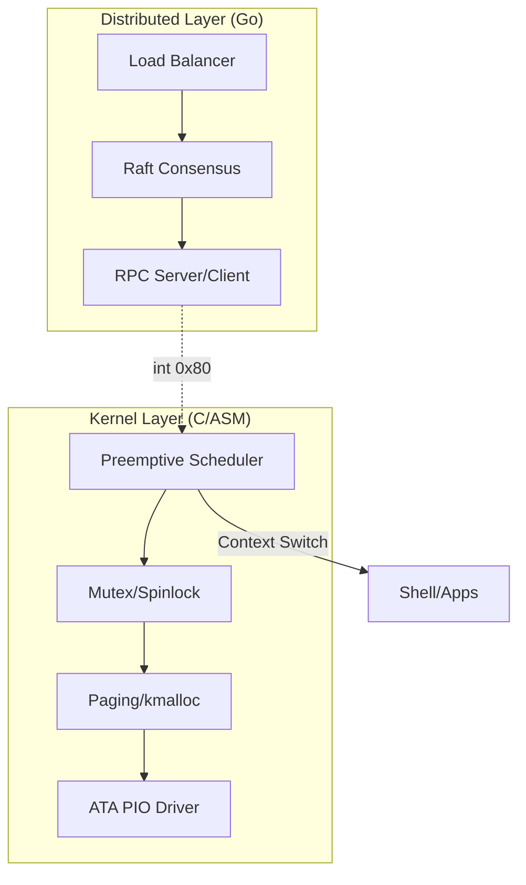

# 🌌 DistributedOS: Bare-Metal Distributed Operating System

A production-grade x86 operating system kernel featuring virtual memory, preemptive multitasking, and a fault-tolerant distributed consensus layer.

---

## 📐 System Architecture

---

## 🎯 Technical Interview Defense (Q&A)

**Q: Why use Paging over simple segmentation?**
**A:** Paging (4KB blocks) prevents external fragmentation and allows us to implement Virtual Memory, making processes think they have their own private address space while isolation is enforced by the CPU.

**Q: Why choose Round Robin for the scheduler?**
**A:** It is the fairest simple scheduling algorithm. Combined with PIT timer interrupts, it ensures no process starves and every task gets a guaranteed time-slice of the CPU.

**Q: Mutex vs Spinlock? When to use which?**
**A:** Spinlocks are used for extremely fast, kernel-internal critical sections (like updating a list). Mutexes are used when the wait might be long; they call `yield()`, giving the CPU to another process instead of burning cycles.

**Q: How does the system handle node failure?**
**A:** We use a Heartbeat mechanism. If a follower node doesn't see a leader heartbeat within the timeout period, it triggers a new Raft election to ensure the cluster always has a source of truth.

**Q: What is the biggest limitation of this OS?**
**A:** Currently, we use ATA PIO for disk I/O, which is CPU-intensive. A production upgrade would implement **DMA (Direct Memory Access)** to offload data transfers to the disk controller.

---

## 🚀 The End-to-End Demo

To run the complete system verification:
1. `cd distributed`
2. `go run demo.go`

**What this verifies**:
1. **Kernel Boot**: Simulation of paging and interrupt setup.
2. **Multitasking**: Concurrent execution of processes A and B.
3. **Synchronization**: Mutex-protected consistency.
4. **Distributed Cluster**: RPC initialization and Load Balancing.
5. **Fault Tolerance**: Automatic leader recovery after a node "death".

---

## 🏗️ Folder Structure
- `/boot`: Bootloader and Linker scripts.
- `/kernel`: Core logic (Memory, Interrupts, Drivers, FS, Net).
- `/distributed`: Go-based consensus and RPC logic.
- `/apps`: Userspace-style shell and commands.
- `/docs`: Detailed architecture and API references.
